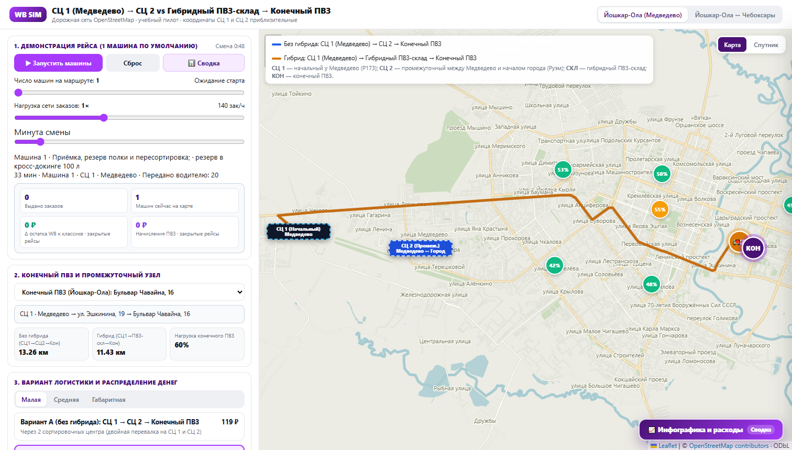

# Mesh-доставка с хранением в ПВЗ

**RWB × Волгатех · номинация «ТОП ИИ СТАРТ» · финальный симулятор v12**

Когда маркетплейсу выгодно передать вторую сортировку из СЦ в пункт выдачи? Симулятор отправляет одинаковый спрос по двум схемам и показывает, сколько заказов каждая успевает доставить за восемь часов, сколько получает ПВЗ и что остаётся у маркетплейса после расходов.

**[Скачать симулятор](https://github.com/scvnkl/hackaton_rwb/raw/refs/heads/main/pvz-wb-real-streets-v12.html)** · [Как устроены расчёты](docs/technical.md) · [Исходный код](pvz-wb-real-streets-v12.html)

Откройте скачанный HTML в браузере на компьютере. Карта улиц, дорожные маршруты и расчётная модель включены в файл. Для запуска не нужны установка, сервер или API-ключ.

## Демо за две минуты

| Время | Что показать |
|---|---|
| 0:00–0:30 | Оставьте Йошкар-Олу и малую посылку. Переключите «Без гибрида» и «Гибрид». На карте видно, какая точка выполняет вторую обработку. |
| 0:30–1:00 | Запустите машины. Передвиньте ползунок минуты смены: положение машины, журнал передачи груза и число выданных заказов изменятся вместе. |
| 1:00–1:30 | Откройте **«Сводка»**. Покажите рекомендацию, разницу в рублях и количество выданных заказов. В **«Инфографика и расходы»** можно развернуть аргумент до цены, километража и выплат на заказ. |
| 1:30–2:00 | Включите **«Пик: все хабы заняты на 99%»**. На том же спросе гибридная политика возвращает партию в СЦ. Причина появится рядом с выбранной цепочкой. |

## Что получается на стартовых настройках

Йошкар-Ола, малая посылка, одна машина, партия из 20 заказов. За смену в модель поступают 1 120 заказов.

| Показатель за 8 часов | Через СЦ | Гибрид |
|---|---:|---:|
| Завершённые рейсы | 5 | 6 |
| Выданные заказы | 100 | 120 |
| Начисления ПВЗ | 1 000 ₽ | 3 120 ₽ |
| Остаток маркетплейса | −4 828,42 ₽ | −3 765,98 ₽ |

**Гибрид доставил на 20 заказов больше и сократил убыток на 1 062,44 ₽.** При этих параметрах ни одна схема не покрыла все расходы смены. Это воспроизводимый пример работы модели с учебными тарифами.

## Какие гипотезы можно проверить

- **Пропускная способность.** Меняйте поток, число машин и размер партии. Выдача засчитывается по факту прохождения модельных операций. В сводке остаётся виден невывезенный спрос.
- **Выбор ПВЗ.** Размеры коробки, масса, свободные литры и минуты сотрудника определяют, сможет ли пункт принять партию. Затем сравниваются дорожные плечи и экономика.
- **Город и межгород.** Для второго города обе политики проходят через СЦ Чебоксар. Время и длина плеч рассчитаны по дорожному графу OpenStreetMap.
- **Хранение до продажи.** Примите десять единиц товара, продайте две и промотайте сутки. Восемь единиц остаются на полке, начисление за сутки составляет 24 ₽.
- **Возврат и пересорт.** Выберите инцидент первого рейса и проверьте журнал сканирований, обратный пробег и изменение остатка WB.

Координаты СЦ 1 и СЦ 2 приблизительные. Спрос, тарифы и нормы обработки — допущения пилота. Описание формул, состава затрат и ограничений находится в [технической документации](docs/technical.md).

## История проекта

| Ветка | Содержимое |
|---|---|
| [main](https://github.com/scvnkl/hackaton_rwb/tree/main) | Финальная версия для защиты |
| [archive/mesh-atlas](https://github.com/scvnkl/hackaton_rwb/tree/archive/mesh-atlas) | Предыдущая платформа Mesh Atlas, её сервер, тесты и городские наборы данных |
| [feature/dispatcher-mesh-pilot](https://github.com/scvnkl/hackaton_rwb/tree/feature/dispatcher-mesh-pilot) | Ранний диспетчерский прототип |
