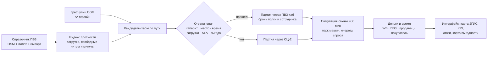

# WB Mesh · ПВЗ по пути вместо второго сортировочного центра

**Хакатон RWB · кейс внутригородской логистики маркетплейса (пилот — Йошкар-Ола).**

Товар уже в городе, покупатель ждёт в соседнем районе, но базовая схема всё равно везёт коробку на второй сортировочный центр (СЦ-2). Мы проверяем гипотезу: **часть пересортировки можно отдать ПВЗ, который стоит по пути и имеет свободные полки, если это дешевле СЦ-2 с учётом дороги по реальным улицам, остановки, обратного пути и выплаты пункту.** MVP — это симулятор смены диспетчера: обе схемы считаются на одних и тех же данных, и видно, где Mesh выигрывает, где проигрывает и почему.


| На стартовом сценарии (Йошкар-Ола, 1 машина, партия 20, смена 8 ч) | A · через СЦ-2 | B · Mesh через ПВЗ | Эффект |
|---|---:|---:|---:|
| Остаток WB за смену | −4 491 ₽ | −1 339 ₽ | **+3 153 ₽ (−21,8% затрат)** |
| Выдано заказов | 80 | 100 | **+20** |
| Затраты WB на заказ | 121 ₽ | 81 ₽ | **−40 ₽** |
| Доставка партии: выезд → выдача | 77 мин | 57 мин | **−20 мин** |
| Цена доставки для покупателя | 125 ₽ | 116 ₽ | −9 ₽ |
| Доход ПВЗ-хаба после оплаты труда | — | 13,8 ₽/коробка | 1 600 ₽ за смену |

## Содержание

1. [Запуск](#запуск)
2. [Проблема, ограничения ПВЗ и условия применения Mesh](#проблема-ограничения-пвз-и-условия-применения-mesh)
3. [Сравнение с базовой схемой на одних данных](#сравнение-с-базовой-схемой-на-одних-данных)
4. [Граница выгодности и устойчивость](#граница-выгодности-и-устойчивость)
5. [Модель выгодности: формулы и участники](#модель-выгодности-формулы-и-участники)
6. [Демонстрация сценариев](#демонстрация-сценариев)
7. [Как устроен MVP](#как-устроен-mvp)
8. [Тиражирование и масштабирование](#тиражирование-и-масштабирование)
9. [План со среды и что изменилось](#план-со-среды-и-что-изменилось)
10. [Данные, источники и ограничения](#данные-источники-и-ограничения)

## Запуск

Сборка и сервер не нужны.

- **Автономный файл:** [скачать `pvz-wb-real-streets-v12.html`](https://github.com/scvnkl/hackaton_rwb/raw/refs/heads/main/pvz-wb-real-streets-v12.html) и открыть в Chrome, Edge или Firefox. Работает без интернета.
- **Из исходников:** открыть `index.html` из клонированного репозитория. Код тот же, что в автономном файле.
- `python tools/build_standalone.py` пересобирает автономный файл после правок.

| Что | Онлайн | Без интернета |
|---|---|---|
| Карта | 2ГИС (ключ не обязателен) | Офлайн-карта OSM из комплекта, переключение автоматическое |
| Маршруты Йошкар-Олы и Чебоксар | Офлайн-граф улиц | Офлайн-граф улиц: все 145 + 264 ПВЗ |
| Маршруты Казани, Москвы, других городов | Граф центра + Valhalla/OSRM | Граф центра + оценка (пунктир) |
| Адреса ПВЗ без адреса в справочнике | Nominatim/Photon, кеш в браузере | Ближайшая улица («ул. Пушкина, рядом») |

Перед показом без интернета выполните `python tools/geocode_catalog.py` и `python tools/build_standalone.py`: адреса Йошкар-Олы и Чебоксар запишутся в комплект, это около 5 минут.

## Проблема, ограничения ПВЗ и условия применения Mesh

**Единица расчёта** — партия заказов (по умолчанию 20 коробок) от СЦ-1 до ПВЗ покупателя. Начало и конец одинаковы в обеих схемах. Меняется только средний этап:

```
A · базовая:  СЦ-1 ──► СЦ-2 (сортировка 25 мин, 52 ₽/коробка) ──► ПВЗ покупателя ──► возврат на СЦ-1
B · Mesh:     СЦ-1 ──► ПВЗ-хаб по пути (3 + 0,4·n мин, выплата 16 ₽/коробка) ──► ПВЗ покупателя ──► возврат на СЦ-1
```

**Ограничения ПВЗ.** Каждое проверяется в коде для каждого кандидата и показывается в чек-листе интерфейса.

| Ограничение | Правило в модели |
|---|---|
| Габарит | Коробка помещается в ячейку 120 × 60 × 50 см и весит до 25 кг (с учётом поворота). Габаритный груз едет через ПВЗ только с согласия покупателя на доплату 120 ₽. |
| Место на полке | Вся партия помещается в свободные литры. Свободный объём = 3 000 л × (1 − фоновая загрузка) − остаток продавца − уже забронированные партии на это время. |
| Загрузка пункта | Фоновая загрузка не выше 80%. Пункты выше порога исключаются. |
| Время сотрудника | Обработка партии помещается в свободные минуты этого часа, в один момент — только одна партия на сотрудника. |
| Срок для покупателя | Задержка к базовой схеме не больше 90 мин. После 20 мин покупатель получает компенсацию 25 ₽/ч. |
| Мотивация ПВЗ | Выплата пункту не меньше стоимости труда (4 ₽/мин): хаб не должен работать в минус. |
| Выгода WB | Вклад WB через хаб не меньше, чем через СЦ-2. |

**Правило выбора.** Если кандидат проходит все ограничения и даёт WB больше, чем СЦ-2, партия идёт через лучший из таких ПВЗ, а его место и время уменьшаются для следующих партий. Иначе партия едет через СЦ-2. Если хаб занят, диспетчер проверяет отсрочку отправки на 15 и 30 минут.

## Сравнение с базовой схемой на одних данных

Обе колонки считаются на одном спросе, парке машин, ставках и дорожном графе. Цифры получены из приложения (смена 480 мин, без изменения стартовых настроек пресета).

| Сценарий | Остаток WB: A → B | Эффект | Выдано A / B | Партий через ПВЗ / СЦ-2 | Доставка партии A / B | Пробег A / B |
|---|---:|---:|---:|---:|---:|---:|
| Старт (1 машина) | −4 491 → −1 339 ₽ | **+3 153 ₽** | 80 / 100 | 5 / 0 | 77 / 57 мин | 103 / 115 км |
| Городской заказ (2 машины) | −4 183 → +2 119 ₽ | **+6 302 ₽** | 160 / 200 | 10 / 0 | 77 / 58 мин | 205 / 231 км |
| Хаб · рост потока (×1,6, партия 40) | +1 677 → +10 817 ₽ | **+9 140 ₽** | 320 / 320 | 8 / 0 | 77 / 66 мин | 205 / 185 км |
| Магистраль Йошкар-Ола → Чебоксары | +12 074 → +17 027 ₽ | **+4 953 ₽** | 180 / 180 | 3 / 0 | 200 / 200 мин | 658 / 659 км |
| Возврат | −4 327 → +1 981 ₽ | **+6 308 ₽** | 160 / 200 (возврат 1 / 1) | 10 / 0 | 77 / 58 мин | 205 / 231 км |
| Ошибка логистики (пересорт) | −4 700 → +1 968 ₽ | **+6 668 ₽** | 140 / 200 | 10 / 0 | 77 / 58 мин | 199 / 232 км |
| Долгое хранение (5 суток) | −5 686 → −4 266 ₽ | **+1 420 ₽** | 40 / 50 | 5 / 0 | 72 / 51 мин | 103 / 115 км |
| **Пик: все хабы заняты на 99%** | −4 183 → −4 183 ₽ | **0 ₽** | 160 / 160 | 0 / 8 | 77 / 77 мин | 205 / 205 км |

Как читать таблицу:
- **Откуда выигрыш.** Убирается устранимая операция СЦ-2 (52 ₽ на коробку и 25 минут). Кроме того, машина быстрее возвращается, поэтому за смену успевает больше рейсов: при одинаковом спросе выдаётся больше заказов.
- **Пробег не всегда меньше.** Крюк через хаб иногда длиннее. Модель считает пробег и время машины в затратах и выбирает хаб, только если итог всё равно лучше.
- **Устойчивость.** При перегрузке пунктов Mesh не навязывается: обе схемы дают одинаковый результат, а партии идут через СЦ-2.

## Граница выгодности и устойчивость

Кнопка «Аналитика → Построить карту выгодности» считает 28 смен: тариф хаба × заполненность полок (партия 20, поток 1×, 2 машины). Эффект Mesh для WB за смену, Йошкар-Ола:

| Полки \ тариф хаба | 10 ₽ | 20 ₽ | 30 ₽ | 40 ₽ | 50 ₽ | 60 ₽ | 70 ₽ |
|---|---:|---:|---:|---:|---:|---:|---:|
| 50% | +7 102 | +5 702 | +4 102 | +2 702 | +1 102 | 0 | 0 |
| 65% | +7 101 | +5 701 | +4 101 | +2 701 | +1 101 | 0 | 0 |
| 80% | +5 521 | +4 381 | +3 121 | +1 981 | +721 | 0 | 0 |
| 90% | 0 | 0 | 0 | 0 | 0 | 0 | 0 |

**Выводы для бизнеса:**
1. **Платить хабу можно до ~50 ₽ за коробку.** Точка безубыточности близка к стоимости устранимой операции СЦ-2 (52 ₽). При выплате 16 ₽ у WB остаётся запас прочности около 3×.
2. **Порог загрузки 80% — граница применимости.** Выше него хаб исключается, и модель автоматически возвращает партии на СЦ-2 без потерь.
3. **Модель не уходит в минус.** Для каждой партии выбирается лучшая из двух схем, поэтому во всех проверенных комбинациях эффект Mesh не ниже нуля: при плохих условиях партии просто идут через СЦ-2.
4. **Выгодно и ПВЗ.** При 16 ₽ хаб зарабатывает 13,8 ₽ на коробку после оплаты труда, то есть около 1 600–5 100 ₽ за смену. Это доход со свободной полки и простаивающего сотрудника.

## Модель выгодности: формулы и участники

Все ставки находятся в `src/config.js` и меняются прямо в интерфейсе (вкладка «Экономика»): смена пересчитывается мгновенно. Подробные формулы — в [docs/technical.md](docs/technical.md).

**Затраты WB на партию из n коробок**

```
Затраты_A = 20·n (СЦ-1) + 52·n (СЦ-2) + 160 (выход машины) + 18 ₽·км + 1,5 ₽·мин + 10·n (выдача в ПВЗ)
Затраты_B = 20·n (СЦ-1) + 16·n (ПВЗ-хаб) + 160 + 18 ₽·км + 1,5 ₽·мин + 10·n
            км и минуты — по графу улиц, включая заезд в хаб, остановку и обратный путь на СЦ-1
Вклад     = цена_покупателя × оплаченные_выдачи − затраты
Эффект смены = Σ вклад_B − Σ вклад_A   (постоянные 4 800 ₽/смена одинаковы в обеих схемах)
```

**Время**

```
Рейс = погрузка 25 мин + Σ дорога + узел + выдача (2 + 0,25·n) + обратный путь
узел A: сортировка СЦ-2 = 25 мин;   узел B: пересортировка в ПВЗ = 3 + 0,4·n мин (n = 20 → 11 мин)
```

Время машины входит в деньги через 1,5 ₽/мин. В интерфейсе время разложено по этапам, а срок для покупателя показан отдельно: от выезда до выдачи, с ожиданием машины и его p95.

**Экономика участников**

| Участник | Что получает и платит | Стартовый сценарий |
|---|---|---|
| **Маркетплейс (WB)** | Выручка от доставки минус затраты рейсов и постоянные расходы смены | −40 ₽ затрат на заказ, +3 153 ₽ за смену |
| **ПВЗ-хаб** | 16 ₽ за коробку пересортировки, плата за хранение 0,8 ₽ за коробко-сутки, +50 ₽ за габарит. Минус труд 4 ₽/мин. Вклад считается до аренды | +13,8 ₽ на коробку, 1 600 ₽ за смену |
| **ПВЗ покупателя** | 10 ₽ за выдачу, 12 ₽ за оформление возврата | одинаково в A и B |
| **Продавец** | Маржа 180 ₽ с продажи минус логистика 55 ₽, хранение 0,8 ₽ за коробко-сутки, возврат 150 ₽ | 125 ₽ с заказа в обеих схемах. Выигрыш в объёме: +20 продаж за смену (≈ +2 500 ₽) |
| **Покупатель** | Тариф по размеру (119 / 179 / 340 ₽) + доля километража. В Mesh — скидка 25% от экономии WB, при задержке компенсация по SLA | 116 ₽ вместо 125 ₽, срок −20 мин |

**Мотивация, штрафы, SLA**

| Механизм | Как работает в модели |
|---|---|
| Мотивация ПВЗ | Сдельная выплата за коробку. Хаб отбирается только если выплата ≥ стоимости труда: пункт не работает в убыток. |
| Мотивация покупателя | Четверть экономии WB возвращается в цене. Габарит через ПВЗ только по согласию и с доплатой. |
| SLA покупателя | Бесплатно до +20 мин к базовой схеме, далее 25 ₽/ч компенсации. Больше +90 мин — хаб запрещён. |
| Ошибка пересорта | Сценарий «Ошибка логистики»: недостача −1, машина возвращается к последней передаче, ищет коробку и повторно выдаёт. WB платит 12 ₽ за исправление, время и пробег входят в расходы. |
| Возврат | Сторно выручки, 12 ₽ оформления пункту выдачи, 150 ₽ на возврат продавцу. |
| Штраф ПВЗ за ошибку | Не реализован в MVP. Для пилота предлагаем удержание стоимости исправления (12 ₽ + время машины) с хаба, допустившего пересорт. |

**Анализ рисков**

| Риск | Как закрыт в модели | Что нужно в пилоте |
|---|---|---|
| ПВЗ переполнен в пик | Порог 80%, бронь литров по времени, отсрочка 15/30 мин, затем СЦ-2 | Реальная загрузка полок по часам из учётной системы ПВЗ |
| Сотрудник не успевает | Бюджет минут на каждый час, одна партия на сотрудника | Замер времени приёмки и пересорта |
| Срыв срока | SLA-компенсация и запрет при +90 мин | Контроль p95 срока по каждой партии |
| Пересорт или недостача | Сценарий ошибки с повторной доставкой и затратами | Скан на каждой передаче, удержание с виновного |
| Нет дороги или данных | Офлайн-граф улиц, онлайн-уточнение, оценка без блокировки расчёта | Собственный роутер (Valhalla/OSRM) |
| Неверные ставки | Все ставки редактируются, карта выгодности показывает запас прочности | Калибровка по фактическим ставкам перевозчика и СЦ |
| Помещение ПВЗ не подходит | Вне модели | Договор, разрешённое использование, подъезд грузовой машины |

## Демонстрация сценариев

Все шесть кейсов из критериев — это кнопки в строке «Сценарии».

| Сценарий | Что задаёт | Что видит жюри |
|---|---|---|
| **Городской заказ** | 2 машины, партия 20, поток 1× | Два хаба по пути, у каждой машины своя цепочка, +6 302 ₽ и +40 выдач |
| **Хаб · рост потока** | Поток ×1,6, партия 40 | Хабы держат рост: тот же объём выдач с меньшим пробегом, +9 140 ₽ |
| **Магистраль** | Йошкар-Ола → Чебоксары, 3 машины | Межгородской рейс через СЦ Чебоксар, последняя миля через ПВЗ-хаб |
| **Возврат** | Возврат одной коробки в первом рейсе | Сторно выручки, оформление возврата в ПВЗ, коробка возвращается на СЦ-1 |
| **Ошибка логистики** | Пересорт одной коробки | Машина возвращается к последней передаче, недостача закрыта, затраты учтены |
| **Долгое хранение** | 10 коробок 5 суток в хабе | Полка занята до отгрузки, продавец платит хабу 40 ₽, кнопка «К моменту отгрузки» |

**Сценарий живого показа на 2 минуты**

| Время | Действие | Что видно |
|---|---|---|
| 0:00–0:20 | Вкладка «Маршрут» на стартовом адресе | Схемы A и B: цена, км, время. Чек-лист — почему партия идёт через хаб |
| 0:20–0:45 | «Городской заказ» → ▶ «Запустить смену» (скорость ×10) | Машины едут по улицам 2ГИС, на карте растут выдачи, экономия и время |
| 0:45–1:05 | «Итоги смены» | +6 302 ₽, партии через ПВЗ и СЦ-2, пробег, срок, нагрузка хабов |
| 1:05–1:25 | «Экономика»: выплата хабу 60 ₽ или галочка «Пик 99%» | Решение переключается на СЦ-2, в чек-листе красным — какое условие не прошло |
| 1:25–1:45 | «Аналитика» → «Построить карту выгодности» | Граница: до ~50 ₽ за коробку и до 80% загрузки |
| 1:45–2:00 | «Возврат», «Ошибка логистики», «Долгое хранение» | Сценарии БП работают в коде, деньги пересчитываются |

## Как устроен MVP



| Слой | Файлы | Что делает |
|---|---|---|
| Ставки | `src/config.js` | Единый источник всех тарифов |
| Данные регионов | `src/core/regions.js`, `citysearch.js`, `data/regions/*` | Справочники ПВЗ четырёх городов, поиск любого города через Overpass, импорт JSON |
| Нагрузка ПВЗ | `src/core/loadindex.js`, `src/model/capacity.js` | Плотность соседей WB/Ozon/Яндекс Маркет, фоновая загрузка, литры, минуты сотрудника, бронь по времени |
| Маршрутизация | `src/core/router.js`, `src/core/roads.js` | Офлайн A* по графу улиц OSM (8 мс на плечо); сохранённые треки Valhalla; онлайн Valhalla/OSRM; оценка |
| Модель рейса и смены | `src/model/trips.js`, `src/model/shift.js` | Фазы рейса, сканы, затраты, выбор хаба, расписание парка, метрики |
| Адреса | `src/core/geocode.js`, `tools/geocode_catalog.py` | Адрес вместо координат: ближайшая улица → геокодер с кешем → запись в комплект |
| Карта | `src/map/*` | Одна подложка 2ГИС с офлайн-резервом, маршруты, ПВЗ по загрузке, машины |
| Интерфейс | `src/ui/*`, `styles/app.css` | Сценарии, вкладки, чек-лист решения, редактор тарифов, формулы, итоги, карта выгодности |

**Проверка**

```bash
node --test tests/dispatch.test.cjs          # 12 тестов модели: маршруты ко всем ПВЗ, ограничения, хранение, возвраты, бюджет
node tests/browser-smoke.cjs                 # браузерные регрессии (нужны Playwright и Chromium)
node tests/browser-smoke.cjs file://$PWD/index.html   # то же для исходников
```

## Тиражирование и масштабирование

**План пилота (6 недель)**

1. **Неделя 1–2 · замеры.** Выбрать 3–5 ПВЗ-кандидатов на коридорах с СЦ и контрольную группу. Записать загрузку полок по часам, время приёмки партии, ставки перевозчика и стоимость операции СЦ-2. Подставить в `config.js` и калибровать индекс загрузки.
2. **Неделя 3–4 · A/B на партиях.** Чередовать сравнимые партии через СЦ-2 и через хаб: тот же адрес, размер и время отправки. По каждой передаче фиксировать время скана, литры, километры, оплату персонала.
3. **Неделя 5–6 · решение.** Сравнить метрики ниже. Если цели выполнены, расширить до всех коридоров города и повторить калибровку порогов.

**Целевые метрики пилота**

| Метрика | Цель | В модели (старт) |
|---|---|---|
| Затраты WB на доставленный заказ | −15% и лучше к контролю | −33% (121 → 81 ₽) |
| Время доставки партии (выезд → выдача) | не хуже контроля | −20 мин (77 → 57) |
| p95 срока с ожиданием машины | не хуже контроля + 20 мин | +3 мин |
| Доля партий через ПВЗ в коридоре | ≥ 50% | 100% |
| Вклад ПВЗ-хаба после труда | > 0 на каждой коробке | 13,8 ₽ |
| Отказы хаба по месту и загрузке | < 10% партий | 0% при загрузке ≤ 80% |
| Ошибки пересорта в хабе | ≤ 0,5% коробок | сценарий учтён |

**Оценка нагрузки**

- **Ёмкость сети ПВЗ (модель, поток 1×).**
  - Йошкар-Ола: 145 ПВЗ WB, средняя загрузка 32%, около 297 000 л свободных полок и 5 600 свободных минут персонала в час. Это теоретически до 10 000 коробок в час пересортировки при партиях по 20.
  - Чебоксары: 264 ПВЗ, около 18 000 коробок в час.
  - Узкое место — не ёмкость, а коридор: хаб должен стоять по пути.
- **Вычисления.** Граф Йошкар-Олы и Чебоксар (120 тыс. вершин) строится за 0,1–0,3 с. Маршрут до ПВЗ — около 8 мс. Смена с выбором хаба для каждой партии — миллисекунды, карта выгодности из 28 смен — около 0,1 с. Всё считается в браузере, сервер не нужен.
- **Для промышленного запуска.** Модель выбора хаба переносится на сервер диспетчеризации как есть (чистые функции без DOM). Её кормят реальной загрузкой полок и ставками.

**Отказоустойчивость** — у каждого внешнего сервиса есть резерв, и расчёт никогда не блокируется:

| Компонент | Основной источник | Резерв 1 | Резерв 2 |
|---|---|---|---|
| Карта | 2ГИС v2 по ключу | Публичные тайлы 2ГИС | Офлайн-карта OSM из комплекта |
| Маршрут | Сохранённый трек Valhalla | Офлайн-граф улиц OSM | Онлайн Valhalla/OSRM → оценка (пунктир) |
| Адрес ПВЗ | Адрес из справочника | Nominatim → Photon (кеш) | Ближайшая улица из графа |
| Хаб | Лучший ПВЗ по пути | Отсрочка 15/30 мин | Базовая схема через СЦ-2 |

**Развитие технического решения**

1. **Любой город РФ.** Поиск ПВЗ через Overpass уже работает в интерфейсе («Данные» → «Другой город»). Следующий шаг — скрипт сборки комплекта по списку городов: ПВЗ, граф улиц, адреса, магистральные плечи.
2. **Межгородские коридоры** (Москва → Казань → Чебоксары → Йошкар-Ола). Магистраль становится отдельным этапом с расписанием. Mesh работает в городе назначения: магистральная машина сдаёт партию в ПВЗ-хаб на въезде, а не на региональный СЦ.
3. **Реальные данные.** Загрузка полок и время сотрудников — из учётной системы ПВЗ, ставки — из договоров. Роутер и тайлы — свои серверы (Valhalla, 2ГИС On-Premise).
4. **Оптимизация.** Сейчас хаб выбирается жадно, лучший для каждой партии. Дальше — совместное планирование партий смены (VRP с ёмкостями ПВЗ).

## План со среды и что изменилось

| Пункт плана | Статус | Где в MVP |
|---|---|---|
| Ядро расчёта: сущности, ограничения по габариту, объёму и времени сотрудника, стоимость обоих сценариев, выбор и обновление ресурсов ПВЗ | ✅ | `src/model/*`, чек-лист решения |
| Данные и маршрутизация: генератор смены, ПВЗ с разной вместимостью и тарифами, расстояния по реальным улицам | ✅ | Справочники 4 городов, индекс плотности, офлайн-граф улиц |
| Симуляция смены и метрики: экономия в ₽ и %, потоки ПВЗ / СЦ-2, пробег, время, загрузка и заработок ПВЗ | ✅ | Плеер смены, KPI, «Итоги смены» |
| Наглядность и проверка гипотез: отчёт, параметры, граница выгодности | ✅ | Редактор тарифов, формулы, карта выгодности |

**Что изменили и почему**

- **Матрица расстояний → офлайн-граф улиц.** Публичный роутер часто не отвечал, и к большинству ПВЗ маршрут не строился. Граф из данных OSM даёт маршрут к любому ПВЗ без интернета. По километрам он расходится с Valhalla меньше чем на 10%.
- **Несколько подложек → одна карта 2ГИС.** Слои OSM и 2ГИС накладывались друг на друга. Теперь на экране одна карта, а офлайн-резерв включается сам.
- **Добавлено сверх плана:** хранение у продавца, возвраты, ошибка пересорта, SLA и компенсации, конкуренция с Ozon и Яндекс Маркетом в загрузке ПВЗ, расчёт времени по этапам, адреса вместо координат.

## Данные, источники и ограничения

| Справочник | Граница | Точек WB | Маршрут по улицам офлайн |
|---|---|---:|---|
| Йошкар-Ола | Пилотная зона Йошкар-Олы и Медведева | 145 | все |
| Чебоксары | Пилотная зона Чебоксар | 264 | все |
| Казань | Административная граница OSM | 307 | центр + онлайн/оценка |
| Москва | Административная граница OSM | 1 286 | центр + онлайн/оценка |

- **Источники.**
  - Точки — OpenStreetMap, исходные ПВЗ пилота v12 и архив проекта Mesh Atlas (справочник «Пункты выдачи»). Совпадающие точки одного бренда в радиусе 30 м объединяются.
  - Ozon и Яндекс Маркет участвуют только в расчёте плотности.
  - [Лицензия OSM](https://www.openstreetmap.org/copyright) · [2ГИС Raster Tiles API](https://docs.2gis.com/maps/others/rastertiles/overview) · [Valhalla](https://valhalla.github.io/valhalla/) · [Nominatim](https://nominatim.org/)
- **Ограничения.**
  - Все ставки учебные. Координаты СЦ — сценарные узлы.
  - Загрузка ПВЗ — модель по плотности соседей, а не замер: калибруется в пилоте.
  - Хаб выбирается для каждой партии отдельно (жадно), без глобальной оптимизации смены.
  - Экономия на СЦ-2 становится деньгами, только если можно сократить оплачиваемые смены или подряд. На постоянном штате это высвобождение времени.
- **Свой город.**
  - В интерфейсе: «Данные» → «Другой город».
  - Заранее: `python tools/build_catalog.py "Самара, Россия" samara.json`, затем загрузить файл в интерфейсе.
  - Формат файла:

```json
{"city":"Учебный район","source":"Пример формата","date":"2026-11-26","depots":[[55.78,49.11],[55.79,49.14]],"points":[{"id":"wb-1","brand":"wb","name":"Пункт А","latlng":[55.79,49.12]},{"id":"ozon-1","brand":"ozon","name":"Пункт В","latlng":[55.781,49.132]}]}
```

Коды брендов — `wb`, `ozon`, `ym`. Порядок СЦ в `depots`: начальный, промежуточный. Координаты — широта, долгота.
