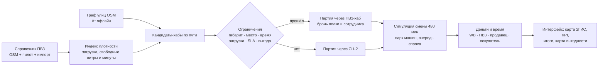

# WB Mesh · ПВЗ по пути вместо второго сортировочного центра

**Хакатон RWB · кейс внутригородской логистики маркетплейса (пилот — Йошкар-Ола).**

Товар уже в городе, покупатель ждёт в соседнем районе, но базовая схема всё равно везёт коробку на второй сортировочный центр (СЦ-2). Мы проверяем гипотезу: **часть пересортировки можно отдать ПВЗ, который стоит по пути и имеет свободные полки, если это дешевле СЦ-2 с учётом дороги по реальным улицам, остановки, обратного пути и выплаты пункту.** MVP — это симулятор смены диспетчера: обе схемы считаются на одних и тех же данных, и видно, где Mesh выигрывает, где проигрывает и почему.


Все ставки откалиброваны по рыночным данным ноября 2026 года — см. [таблицу источников](#ставки-модели-и-источники).

| На стартовом сценарии (Йошкар-Ола, 1 машина, партия 20, смена 8 ч) | A · через СЦ-2 | B · Mesh через ПВЗ | Эффект |
|---|---:|---:|---:|
| Результат WB за смену¹ | −7 476 ₽ | −6 272 ₽ | **+1 204 ₽ (−6,9% затрат)** |
| Выдано заказов | 80 | 100 | **+20 (+25%)** |
| Затраты WB на заказ | 157 ₽ | 134 ₽ | **−23 ₽ (−15%)** |
| Доставка партии: выезд → выдача | 77 мин | 59 мин | **−18 мин** |
| Цена доставки для покупателя | 124 ₽ | 119 ₽ | −5 ₽ |
| Доход ПВЗ-хаба после оплаты труда | — | 12,7 ₽/коробка | 1 270 ₽ за смену |

¹ Обе схемы в минусе, потому что выручка WB в модели — только плата за доставку, без комиссии с продажи. Решение принимается по разнице схем, и она не зависит от этого допущения.

## Продукт: пульт логиста городской доставки

**Для кого.** Логист городской доставки WB — сотрудник СЦ, который планирует смену машин между СЦ и ПВЗ города.

**Для чего.** Сейчас каждая партия едет через второй СЦ, даже когда рядом по пути есть ПВЗ со свободными полками. Пульт по каждой партии сам выбирает: ПВЗ-хаб по пути или СЦ-2. Он бронирует место и время сотрудника хаба и считает эффект. Логист подтверждает только исключения.

**Что видно на первом экране (вкладка «Пульт»):**
- сколько партий решено автоматически, сколько ушло через хабы и экономия смены;
- «Нужно ваше решение»: исключения с причиной и кнопками «Подтвердить операцию» и «Через СЦ-2», одинаковые сведены в одну карточку;
- партии смены: время отправки, машина, путь, эффект в ₽ и статус («Ждёт», «В пути», «Выдан»); клик по строке показывает партию на карте;
- ПВЗ-хабы сегодня и блок «что система делает сама, а что — логист».

Для срочного заказа логист сравнивает цену и время попутного такси с отдельным выездом «Газели». После назначения такси пульт записывает заказ в журнал и отмечает путь машины на карте.

Задачи логиста, разделение «автоматически / вручную», функциональные и нефункциональные требования, интеграции для пилота — в **[docs/product.md](product.md)**.

## Для кого и что даёт

Цифры — одна линия доставки на стартовом сценарии (1 машина, партия 20), реальные ставки 2026 года. Месяц = 30 смен по 8 часов. В приложении это вкладка **«Эффект»**: переключатель ролей, метрики и то, как решение выглядит у каждого участника.

| Кто | Боль сейчас | Что даёт Mesh | Ключевые метрики |
|---|---|---|---|
| **Маркетплейс (логистика WB)** | Товар уже в городе, но каждая коробка едет через СЦ-2: +25 ₽ и +25 мин | Те же машины везут больше заказов дешевле и быстрее | **+36 тыс. ₽/мес** на линии (+80,7 тыс. при 2 машинах) · затраты на заказ **−15%** (157 → 134 ₽) · **+25%** заказов на тех же машинах (80 → 100 за смену) · доставка партии **−18 мин** · СЦ-2 разгружен на 3 000 коробок/мес |
| **Продавец** | Заказ ждёт второй сортировки, часть заказов переносится на завтра | Заказы приезжают раньше, за день доставляется больше, доставка для покупателя дешевле | **+46,8 тыс. ₽/мес** маржи продавцов на линии (+20 продаж за смену × 78 ₽) · срок до ПВЗ **−18 мин** · логистика продавца не дорожает (102 ₽ за коробку 5 л в обеих схемах) |
| **Владелец ПВЗ** | Доход только от выдачи, полки и сотрудник простаивают в часы спада | Новый доход: уровень «ПВЗ-хаб» и пересортировка транзита в выделенной зоне | **+36,8 тыс. ₽/мес** одному хабу после труда (6 ₽/мин) и аренды (800 ₽/м²) · 55 мин работы в день · стеллажи окупаются за **17 дней** |
| **Покупатель** | Заказ уже в городе, а приходит позже | Раньше и дешевле | Доставка **119 ₽ вместо 124 ₽ (−4%)** · на **18 мин** раньше · компенсация при задержке > 20 мин |

### Уровень «ПВЗ-хаб»: делать или нет — делать

Владелец ПВЗ выделяет в пункте отдельную зону под транзитные партии (по умолчанию 1 000 л, это около 1,7 м² стеллажа) и время сотрудника на приём (20 мин в час). Взамен получает выплату WB за каждую коробку. В модели это переключатель во вкладке «Эффект» → «Владелец ПВЗ».

| | Обычный ПВЗ на свободных полках | ПВЗ с уровнем «хаб» |
|---|---|---|
| Ёмкость под транзит | Остаток после покупателей, плавает с потоком | Гарантированная зона, не зависит от потока |
| В пик (полки заняты на 99%) | Выпадает: эффект Mesh **0 ₽**, все партии на СЦ-2 | Работает: эффект **+1 204 ₽ за смену**, 5 из 5 партий через хаб |
| Для WB | Нельзя обещать срок и объём | Можно планировать и закладывать в SLA |
| Для владельца | Случайный доход | +36,8 тыс. ₽/мес на одной линии. Затраты: аренда зоны 1 333 ₽/мес, стеллажи 20 000 ₽ разово |
| Риски | Транзит смешан с заказами покупателей | Отдельная зона: меньше пересортов, проще ответственность |

**Почему стоит делать:** уровень хаба превращает «свободные полки, если повезёт» в гарантированную мощность. Без неё Mesh отключается в пик, то есть как раз тогда, когда СЦ-2 перегружен сильнее всего. Владелец платит за это меньше 2 м² площади, а окупает примерно за 17 дней.

**Условия входа для пилота:** зона от 0,6 м², подъезд для фургона, сканер на приёме, график приёма партий. Уровень снимается после двух ошибок пересорта за месяц.

## Содержание

1. [Запуск](#запуск)
2. [Проблема, ограничения ПВЗ и условия применения Mesh](#проблема-ограничения-пвз-и-условия-применения-mesh)
3. [Сравнение с базовой схемой на одних данных](#сравнение-с-базовой-схемой-на-одних-данных)
4. [Граница выгодности и устойчивость](#граница-выгодности-и-устойчивость)
5. [Модель выгодности: формулы и участники](#модель-выгодности-формулы-и-участники)
6. [Как устроен MVP](#как-устроен-mvp)
7. [Тиражирование и масштабирование](#тиражирование-и-масштабирование)
8. [План со среды и что изменилось](#план-со-среды-и-что-изменилось)
9. [Данные, источники и ограничения](#данные-источники-и-ограничения)

## Запуск

Сборка и сервер не нужны.

- **Автономный файл:** [скачать `pvz-wb-real-streets-v12.html`](https://github.com/scvnkl/hackaton_rwb/raw/refs/heads/main/pvz-wb-real-streets-v12.html) и открыть в Chrome, Edge или Firefox. Работает без интернета.
- **Из исходников:** открыть `index.html` из клонированного репозитория. Код тот же, что в автономном файле.
- `python tools/build_standalone.py` пересобирает автономный файл после правок.

| Что | Онлайн | Без интернета |
|---|---|---|
| Карта | 2ГИС (ключ не обязателен) | Офлайн-карта OSM из комплекта, переключение автоматическое |
| Маршруты Йошкар-Олы и Чебоксар | Офлайн-граф улиц | Офлайн-граф улиц: все 145 + 264 ПВЗ |
| Маршруты Казани, Москвы, других городов | Граф центра + Valhalla/OSRM | Граф центра + оценка (пунктир) |
| Адреса ПВЗ без адреса в справочнике | Nominatim/Photon, кеш в браузере | Ближайшая улица («ул. Пушкина, рядом») |

Перед показом без интернета выполните `python tools/geocode_catalog.py` и `python tools/build_standalone.py`: адреса Йошкар-Олы и Чебоксар запишутся в комплект, это около 5 минут.

## Проблема, ограничения ПВЗ и условия применения Mesh

**Единица расчёта** — партия заказов (по умолчанию 20 коробок) от СЦ-1 до ПВЗ покупателя. Начало и конец одинаковы в обеих схемах. Меняется только средний этап:

```
A · базовая:  СЦ-1 ──► СЦ-2 (сортировка 25 мин, 25 ₽/коробка) ──► ПВЗ покупателя ──► возврат на СЦ-1
B · Mesh:     СЦ-1 ──► ПВЗ-хаб по пути (3 + 0,4·n мин, выплата 16 ₽/коробка) ──► ПВЗ покупателя ──► возврат на СЦ-1
```

**Ограничения ПВЗ.** Каждое проверяется в коде для каждого кандидата и показывается в чек-листе интерфейса.

| Ограничение | Правило в модели |
|---|---|
| Габарит | Коробка помещается в ячейку 120 × 60 × 50 см и весит до 25 кг (с учётом поворота). Габаритный груз едет через ПВЗ только с согласия покупателя на доплату 120 ₽. |
| Место на полке | Вся партия помещается в свободные литры. Свободный объём = 3 000 л × (1 − фоновая загрузка) − остаток продавца − уже забронированные партии на это время. |
| Загрузка пункта | Фоновая загрузка не выше 80%. Пункты выше порога исключаются. |
| Время сотрудника | Обработка партии помещается в свободные минуты этого часа, в один момент — только одна партия на сотрудника. |
| Срок для покупателя | Задержка к базовой схеме не больше 90 мин. После 20 мин покупатель получает компенсацию 25 ₽/ч. |
| Мотивация ПВЗ | Выплата пункту не меньше стоимости труда (6 ₽/мин): хаб не должен работать в минус. |
| Выгода WB | Вклад WB через хаб не меньше, чем через СЦ-2. |

**Правило выбора.** Если кандидат проходит все ограничения и даёт WB больше, чем СЦ-2, партия идёт через лучший из таких ПВЗ, а его место и время уменьшаются для следующих партий. Иначе партия едет через СЦ-2. Если хаб занят, диспетчер проверяет отсрочку отправки на 15 и 30 минут.

## Сравнение с базовой схемой на одних данных

Обе колонки считаются на одном спросе, парке машин, ставках и дорожном графе. Цифры получены из приложения (смена 480 мин, без изменения стартовых настроек пресета).

| Сценарий | Остаток WB: A → B | Эффект | Выдано A / B | Партий через ПВЗ / СЦ-2 | Доставка партии A / B | Пробег A / B |
|---|---:|---:|---:|---:|---:|---:|
| Старт (1 машина) | −7 476 → −6 272 ₽ | **+1 204 ₽** | 80 / 100 | 5 / 0 | 77 / 59 мин | 103 / 115 км |
| Городской заказ (2 машины) | −10 151 → −7 461 ₽ | **+2 690 ₽** | 160 / 180 | 9 / 0 | 77 / 58 мин | 205 / 210 км |
| Хаб · рост потока (×1,6, партия 40) | −311 → +3 162 ₽ | **+3 473 ₽** | 320 / 320 | 8 / 0 | 77 / 66 мин | 205 / 185 км |
| Магистраль Йошкар-Ола → Чебоксары | +6 652 → +8 096 ₽ | **+1 444 ₽** | 180 / 180 | 3 / 0 | 200 / 196 мин | 658 / 655 км |
| Возврат | −10 357 → −7 662 ₽ | **+2 695 ₽** | 160 / 180 (возврат 1 / 1) | 9 / 0 | 77 / 58 мин | 205 / 210 км |
| Ошибка логистики (пересорт) | −10 474 → −7 861 ₽ | **+2 613 ₽** | 140 / 180 | 9 / 0 | 77 / 58 мин | 199 / 210 км |
| Долгое хранение (5 суток) | −9 376 → −8 914 ₽ | **+462 ₽** | 40 / 50 | 5 / 0 | 72 / 49 мин | 103 / 115 км |
| **Пик: все хабы заняты на 99%** | −10 151 → −10 151 ₽ | **0 ₽** | 160 / 160 | 0 / 8 | 77 / 77 мин | 205 / 205 км |

Как читать таблицу:
- **Откуда выигрыш.** Убирается устранимая операция СЦ-2 (25 ₽ на коробку и 25 минут). Минута «Газели» с водителем стоит 14 ₽, поэтому сэкономленные минуты весят больше, чем сама сортировка. Кроме того, машина быстрее возвращается, поэтому за смену успевает больше рейсов: при одинаковом спросе выдаётся больше заказов.
- **Пробег не всегда меньше.** Крюк через хаб иногда длиннее. Модель считает пробег и время машины в затратах и выбирает хаб, только если итог всё равно лучше.
- **Устойчивость.** При перегрузке пунктов Mesh не навязывается: обе схемы дают одинаковый результат, а партии идут через СЦ-2.

## Граница выгодности и устойчивость

Кнопка «Аналитика → Построить карту выгодности» считает 28 смен: тариф хаба × заполненность полок (партия 20, поток 1×, 2 машины). Эффект Mesh для WB за смену, Йошкар-Ола:

| Полки \ тариф хаба | 10 ₽ | 20 ₽ | 30 ₽ | 40 ₽ | 50 ₽ | 60 ₽ | 70 ₽ |
|---|---:|---:|---:|---:|---:|---:|---:|
| 50% | +3 324 | +2 150 | +324 | −1 276 | 0 | 0 | 0 |
| 65% | +3 324 | +2 150 | +324 | −1 276 | 0 | 0 | 0 |
| 80% | +3 629 | +2 409 | +1 229 | +43 | 0 | 0 | 0 |
| 90% | 0 | 0 | 0 | 0 | 0 | 0 | 0 |

**Выводы для бизнеса:**
1. **Платить хабу можно до ~30 ₽ за коробку.** Точка безубыточности лежит между 30 и 40 ₽, рядом со стоимостью операции СЦ-2 (25 ₽) плюс сэкономленное время машины. При выплате 16 ₽ запас прочности — почти двукратный.
2. **Порог загрузки 80% — граница применимости.** Выше него хаб исключается, и модель автоматически возвращает партии на СЦ-2 без потерь.
3. **На границе есть зона риска.** Хаб выбирается для каждой партии отдельно (жадно). При тарифе 40 ₽ и загрузке 50–65% каждая партия формально чуть выгоднее через хаб, но за смену это даёт −1 276 ₽: хабы сдвигают расписание машин. Вывод для пилота: тариф держать не выше 30 ₽, а следующий шаг модели — планировать смену целиком.
4. **Выгодно и ПВЗ.** При 16 ₽ хаб зарабатывает 12,7 ₽ на коробку после оплаты труда 6 ₽/мин, то есть около 1 270–4 200 ₽ за смену. Это доход со свободной полки и простаивающего сотрудника.

## Модель выгодности: формулы и участники

Все ставки находятся в `src/config.js` и меняются прямо в интерфейсе (вкладка «Экономика»): смена пересчитывается мгновенно. Подробные формулы — в [docs/technical.md](technical.md).

**Затраты WB на партию из n коробок**

```
Затраты_A = 20·n (СЦ-1) + 25·n (СЦ-2) + 160 (выход машины) + 15 ₽·км + 14 ₽·мин + 10·n (выдача в ПВЗ)
Затраты_B = 20·n (СЦ-1) + 16·n (ПВЗ-хаб) + 160 + 15 ₽·км + 14 ₽·мин + 10·n
            км и минуты — по графу улиц, включая заезд в хаб, остановку и обратный путь на СЦ-1
Вклад     = цена_покупателя × оплаченные_выдачи − затраты
Эффект смены = Σ вклад_B − Σ вклад_A   (постоянные 4 800 ₽/смена одинаковы в обеих схемах)
```

**Время**

```
Рейс = погрузка 25 мин + Σ дорога + узел + выдача (2 + 0,25·n) + обратный путь
узел A: сортировка СЦ-2 = 25 мин;   узел B: пересортировка в ПВЗ = 3 + 0,4·n мин (n = 20 → 11 мин)
```

Время машины входит в деньги через 14 ₽/мин. В интерфейсе время разложено по этапам, а срок для покупателя показан отдельно: от выезда до выдачи, с ожиданием машины и его p95.

**Экономика участников**

| Участник | Что получает и платит | Стартовый сценарий |
|---|---|---|
| **Маркетплейс (WB)** | Выручка от доставки минус затраты рейсов и постоянные расходы смены | −23 ₽ затрат на заказ, +1 204 ₽ за смену |
| **ПВЗ-хаб** | 16 ₽ за коробку пересортировки, плата за хранение 0,4 ₽ за коробко-сутки, +50 ₽ за габарит. Минус труд 6 ₽/мин. С уровнем «ПВЗ-хаб» — минус аренда зоны | +12,7 ₽ на коробку, 1 270 ₽ за смену |
| **ПВЗ покупателя** | 10 ₽ за выдачу, 12 ₽ за оформление возврата | одинаково в A и B |
| **Продавец** | Условная маржа 180 ₽ с продажи минус логистика WB 102 ₽ (коробка 5 л), хранение 0,4 ₽ за коробко-сутки, возврат 150 ₽ | 78 ₽ с заказа в обеих схемах. Выигрыш в объёме: +20 продаж за смену (≈ +1 560 ₽) |
| **Покупатель** | Тариф по размеру (119 / 179 / 340 ₽) + доля километража. В Mesh — скидка 25% от экономии WB, при задержке компенсация по SLA | 119 ₽ вместо 124 ₽, срок −18 мин |

**Мотивация, штрафы, SLA**

| Механизм | Как работает в модели |
|---|---|
| Мотивация ПВЗ | Сдельная выплата за коробку. Хаб отбирается только если выплата ≥ стоимости труда: пункт не работает в убыток. |
| Мотивация покупателя | Четверть экономии WB возвращается в цене. Габарит через ПВЗ только по согласию и с доплатой. |
| SLA покупателя | Бесплатно до +20 мин к базовой схеме, далее 25 ₽/ч компенсации. Больше +90 мин — хаб запрещён. |
| Ошибка пересорта | Сценарий «Ошибка логистики»: недостача −1, машина возвращается к последней передаче, ищет коробку и повторно выдаёт. WB платит 12 ₽ за исправление, время (14 ₽/мин) и пробег входят в расходы. |
| Возврат | Сторно выручки, 12 ₽ оформления пункту выдачи, 150 ₽ на возврат продавцу. |
| Штраф ПВЗ за ошибку | Не реализован в MVP. Для пилота предлагаем удержание стоимости исправления (12 ₽ + время машины) с хаба, допустившего пересорт. |

**Анализ рисков**

| Риск | Как закрыт в модели | Что нужно в пилоте |
|---|---|---|
| ПВЗ переполнен в пик | Порог 80%, бронь литров по времени, отсрочка 15/30 мин, затем СЦ-2 | Реальная загрузка полок по часам из учётной системы ПВЗ |
| Сотрудник не успевает | Бюджет минут на каждый час, одна партия на сотрудника | Замер времени приёмки и пересорта |
| Срыв срока | SLA-компенсация и запрет при +90 мин | Контроль p95 срока по каждой партии |
| Пересорт или недостача | Сценарий ошибки с повторной доставкой и затратами | Скан на каждой передаче, удержание с виновного |
| Нет дороги или данных | Офлайн-граф улиц, онлайн-уточнение, оценка без блокировки расчёта | Собственный роутер (Valhalla/OSRM) |
| Неверные ставки | Все ставки редактируются, карта выгодности показывает запас прочности | Калибровка по фактическим ставкам перевозчика и СЦ |
| Помещение ПВЗ не подходит | Вне модели | Договор, разрешённое использование, подъезд грузовой машины |

## Как устроен MVP



| Слой | Файлы | Что делает |
|---|---|---|
| Ставки | `src/config.js` | Единый источник всех тарифов |
| Данные регионов | `src/core/regions.js`, `citysearch.js`, `data/regions/*` | Справочники ПВЗ четырёх городов, поиск любого города через Overpass, импорт JSON |
| Нагрузка ПВЗ | `src/core/loadindex.js`, `src/model/capacity.js` | Плотность соседей WB/Ozon/Яндекс Маркет, фоновая загрузка, литры, минуты сотрудника, бронь по времени |
| Маршрутизация | `src/core/router.js`, `src/core/roads.js` | Офлайн A* по графу улиц OSM (8 мс на плечо); сохранённые треки Valhalla; онлайн Valhalla/OSRM; оценка |
| Модель рейса и смены | `src/model/trips.js`, `src/model/shift.js` | Фазы рейса, сканы, затраты, выбор хаба, расписание парка, метрики |
| Адреса | `src/core/geocode.js`, `tools/geocode_catalog.py` | Адрес вместо координат: ближайшая улица → геокодер с кешем → запись в комплект |
| Карта | `src/map/*` | Одна подложка 2ГИС с офлайн-резервом, маршруты, ПВЗ по загрузке, машины |
| Пульт логиста | `src/ui/logist.js` | Первый экран: очередь партий смены, решения системы, исключения на подтверждение, хабы дня |
| Бизнес-эффект | `src/ui/business.js` | Вкладка «Эффект»: метрики и экраны маркетплейса, продавца, владельца ПВЗ и покупателя; уровень «ПВЗ-хаб» и устойчивость в пик |
| Интерфейс | `src/ui/*`, `styles/app.css` | Сценарии, вкладки, чек-лист решения, редактор тарифов, формулы, итоги, карта выгодности |

**Проверка**

```bash
node --test tests/dispatch.test.cjs          # 14 тестов модели: маршруты ко всем ПВЗ, ограничения, хранение, возвраты, бюджет
node tests/browser-smoke.cjs                 # браузерные регрессии (нужны Playwright и Chromium)
node tests/browser-smoke.cjs file://$PWD/index.html   # то же для исходников
```

## Тиражирование и масштабирование

**План пилота (6 недель)**

1. **Неделя 1–2 · замеры и отбор хабов.** Выбрать 3–5 ПВЗ на коридорах с СЦ, владельцы которых готовы перейти на уровень «ПВЗ-хаб» (выделить зону от 0,6 м² и время сотрудника), и контрольную группу. Записать загрузку полок по часам, время приёмки партии, ставки перевозчика и стоимость операции СЦ-2. Подставить в `config.js` и калибровать индекс загрузки.
2. **Неделя 3–4 · A/B на партиях.** Чередовать сравнимые партии через СЦ-2 и через хаб: тот же адрес, размер и время отправки. По каждой передаче фиксировать время скана, литры, километры, оплату персонала.
3. **Неделя 5–6 · решение.** Сравнить метрики ниже. Если цели выполнены, расширить до всех коридоров города и повторить калибровку порогов.

**Целевые метрики пилота**

| Метрика | Цель | В модели (старт) |
|---|---|---|
| Затраты WB на доставленный заказ | −10% и лучше к контролю | −15% (157 → 134 ₽) |
| Время доставки партии (выезд → выдача) | не хуже контроля | −18 мин (77 → 59) |
| p95 срока с ожиданием машины | не хуже контроля + 20 мин | +8 мин |
| Доля партий через ПВЗ в коридоре | ≥ 50% | 100% |
| Вклад ПВЗ-хаба после труда | > 0 на каждой коробке | 12,7 ₽ |
| Доп. доход владельца хаба | ≥ 20 тыс. ₽/мес, окупаемость зоны < 1 мес | 36,8 тыс. ₽/мес, 17 дней |
| Доля партий через хаб в пик | ≥ 80% при уровне «ПВЗ-хаб» | 100% (5 из 5) |
| Отказы хаба по месту и загрузке | < 10% партий | 0% при загрузке ≤ 80% |
| Ошибки пересорта в хабе | ≤ 0,5% коробок | сценарий учтён |

**Оценка нагрузки**

- **Ёмкость сети ПВЗ (модель, поток 1×).**
  - Йошкар-Ола: 145 ПВЗ WB, средняя загрузка 32%, около 297 000 л свободных полок и 5 600 свободных минут персонала в час. Это теоретически до 10 000 коробок в час пересортировки при партиях по 20.
  - Чебоксары: 264 ПВЗ, около 18 000 коробок в час.
  - Узкое место — не ёмкость, а коридор: хаб должен стоять по пути.
- **Вычисления.** Граф Йошкар-Олы и Чебоксар (120 тыс. вершин) строится за 0,1–0,3 с. Маршрут до ПВЗ — около 8 мс. Смена с выбором хаба для каждой партии — миллисекунды, карта выгодности из 28 смен — около 0,1 с. Всё считается в браузере, сервер не нужен.
- **Для промышленного запуска.** Модель выбора хаба переносится на сервер диспетчеризации как есть (чистые функции без DOM). Её кормят реальной загрузкой полок и ставками.

**Отказоустойчивость** — у каждого внешнего сервиса есть резерв, и расчёт никогда не блокируется:

| Компонент | Основной источник | Резерв 1 | Резерв 2 |
|---|---|---|---|
| Карта | 2ГИС v2 по ключу | Публичные тайлы 2ГИС | Офлайн-карта OSM из комплекта |
| Маршрут | Сохранённый трек Valhalla | Офлайн-граф улиц OSM | Онлайн Valhalla/OSRM → оценка (пунктир) |
| Адрес ПВЗ | Адрес из справочника | Nominatim → Photon (кеш) | Ближайшая улица из графа |
| Хаб | Лучший ПВЗ по пути | Отсрочка 15/30 мин | Базовая схема через СЦ-2 |

**Развитие технического решения**

1. **Любой город РФ.** Поиск ПВЗ через Overpass уже работает в интерфейсе («Данные» → «Другой город»). Следующий шаг — скрипт сборки комплекта по списку городов: ПВЗ, граф улиц, адреса, магистральные плечи.
2. **Межгородские коридоры** (Москва → Казань → Чебоксары → Йошкар-Ола). Магистраль становится отдельным этапом с расписанием. Mesh работает в городе назначения: магистральная машина сдаёт партию в ПВЗ-хаб на въезде, а не на региональный СЦ.
3. **Реальные данные.** Загрузка полок и время сотрудников — из учётной системы ПВЗ, ставки — из договоров. Роутер и тайлы — свои серверы (Valhalla, 2ГИС On-Premise).
4. **Оптимизация.** Сейчас хаб выбирается жадно, лучший для каждой партии. Дальше — совместное планирование партий смены (VRP с ёмкостями ПВЗ).

## План со среды и что изменилось

| Пункт плана | Статус | Где в MVP |
|---|---|---|
| Ядро расчёта: сущности, ограничения по габариту, объёму и времени сотрудника, стоимость обоих сценариев, выбор и обновление ресурсов ПВЗ | ✅ | `src/model/*`, чек-лист решения |
| Данные и маршрутизация: генератор смены, ПВЗ с разной вместимостью и тарифами, расстояния по реальным улицам | ✅ | Справочники 4 городов, индекс плотности, офлайн-граф улиц |
| Симуляция смены и метрики: экономия в ₽ и %, потоки ПВЗ / СЦ-2, пробег, время, загрузка и заработок ПВЗ | ✅ | Плеер смены, KPI, «Итоги смены» |
| Наглядность и проверка гипотез: отчёт, параметры, граница выгодности | ✅ | Редактор тарифов, формулы, карта выгодности |

**Что изменили и почему**

- **Матрица расстояний → офлайн-граф улиц.** Публичный роутер часто не отвечал, и к большинству ПВЗ маршрут не строился. Граф из данных OSM даёт маршрут к любому ПВЗ без интернета. По километрам он расходится с Valhalla меньше чем на 10%.
- **Несколько подложек → одна карта 2ГИС.** Слои OSM и 2ГИС накладывались друг на друга. Теперь на экране одна карта, а офлайн-резерв включается сам.
- **Добавлено сверх плана:** хранение у продавца, возвраты, ошибка пересорта, SLA и компенсации, конкуренция с Ozon и Яндекс Маркетом в загрузке ПВЗ, расчёт времени по этапам, адреса вместо координат.

## Ставки модели и источники

Ставки откалиброваны по открытым рыночным данным на ноябрь 2026 года. Все они лежат в `src/config.js` и редактируются во вкладке «Экономика».

| Ставка | Было (учебная) | Стало | Основание |
|---|---:|---:|---|
| Время машины с водителем | 1,5 ₽/мин | **14 ₽/мин** | «Газель» с водителем — около 1 100 ₽/ч за дополнительный час (тариф перевозчика в Казани), без топливной части |
| Пробег | 18 ₽/км | **15 ₽/км** | АИ-92 ≈ 72,5 ₽/л (Росстат, начало ноября 2026) × 14–15 л/100 км у «Газели» ≈ 10,5 ₽/км + шины и ТО |
| Труд сотрудника ПВЗ | 4 ₽/мин | **6 ₽/мин** | Менеджер ПВЗ WB: 66–84 тыс. ₽/мес на руки при сменах по 12 ч (вакансии hh.ru, 2026) |
| Аренда зоны хаба | 900 ₽/м² | **800 ₽/м²** | Йошкар-Ола: склад ≈ 350 ₽/м², помещение на первой линии ≈ 810 ₽/м² в месяц (Яндекс Недвижимость) |
| Логистика продавца | 55 ₽ | **102 ₽** | WB с 23.03.2026: 46 ₽ за первый литр + 14 ₽ за каждый следующий; коробка 5 л |
| Хранение | 0,8 ₽ | **0,4 ₽** за коробко-сутки | Хранение на складах WB — порядка 0,04–0,07 ₽ в день; для ПВЗ рядом с покупателем заложена надбавка |
| Сортировка на СЦ-2 | 52 ₽ | **25 ₽** за коробку | **Оценка команды.** Открытых данных о себестоимости сортировки нет. Это главная неопределённость: граница выгодности показывает запас |
| Выплата ПВЗ-хабу | 16 ₽ | 16 ₽ | Предложение команды: ≈ 2,7× стоимости труда на коробку (0,55 мин × 6 ₽/мин) |

**Что изменилось после калибровки.** Эффект стал скромнее, но остался положительным во всех шести сценариях:
- старт: +3 153 → **+1 204 ₽** за смену;
- затраты на заказ: −33% → **−15%**;
- граница тарифа хаба: ~50 → **~30 ₽** за коробку.

Главный вклад теперь даёт не сортировка, а время машины: минута стоит в 9 раз дороже, чем в учебной модели. Регрессионные тесты закреплены на учебных ставках, отдельный тест проверяет выгоду при реальных.

## Данные, источники и ограничения

| Справочник | Граница | Точек WB | Маршрут по улицам офлайн |
|---|---|---:|---|
| Йошкар-Ола | Пилотная зона Йошкар-Олы и Медведева | 145 | все |
| Чебоксары | Пилотная зона Чебоксар | 264 | все |
| Казань | Административная граница OSM | 307 | центр + онлайн/оценка |
| Москва | Административная граница OSM | 1 286 | центр + онлайн/оценка |

- **Источники.**
  - Точки — OpenStreetMap, исходные ПВЗ пилота v12 и архив проекта Mesh Atlas (справочник «Пункты выдачи»). Совпадающие точки одного бренда в радиусе 30 м объединяются.
  - Ozon и Яндекс Маркет участвуют только в расчёте плотности.
  - [Лицензия OSM](https://www.openstreetmap.org/copyright) · [2ГИС Raster Tiles API](https://docs.2gis.com/maps/others/rastertiles/overview) · [Valhalla](https://valhalla.github.io/valhalla/) · [Nominatim](https://nominatim.org/)
- **Ограничения.**
  - Все ставки учебные. Координаты СЦ — сценарные узлы.
  - Загрузка ПВЗ — модель по плотности соседей, а не замер: калибруется в пилоте.
  - Хаб выбирается для каждой партии отдельно (жадно), без глобальной оптимизации смены.
  - Экономия на СЦ-2 становится деньгами, только если можно сократить оплачиваемые смены или подряд. На постоянном штате это высвобождение времени.
- **Свой город.**
  - В интерфейсе: «Данные» → «Другой город».
  - Заранее: `python tools/build_catalog.py "Самара, Россия" samara.json`, затем загрузить файл в интерфейсе.
  - Формат файла:

```json
{"city":"Учебный район","source":"Пример формата","date":"2026-11-26","depots":[[55.78,49.11],[55.79,49.14]],"points":[{"id":"wb-1","brand":"wb","name":"Пункт А","latlng":[55.79,49.12]},{"id":"ozon-1","brand":"ozon","name":"Пункт В","latlng":[55.781,49.132]}]}
```

Коды брендов — `wb`, `ozon`, `ym`. Порядок СЦ в `depots`: начальный, промежуточный. Координаты — широта, долгота.
